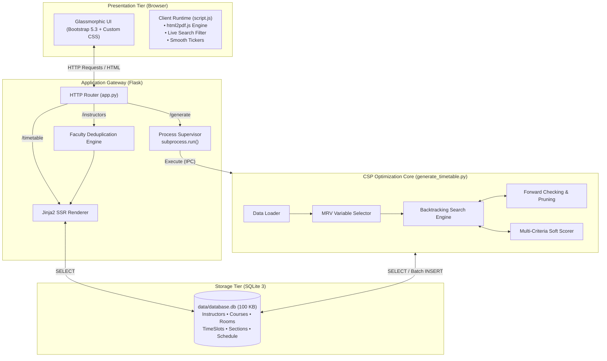
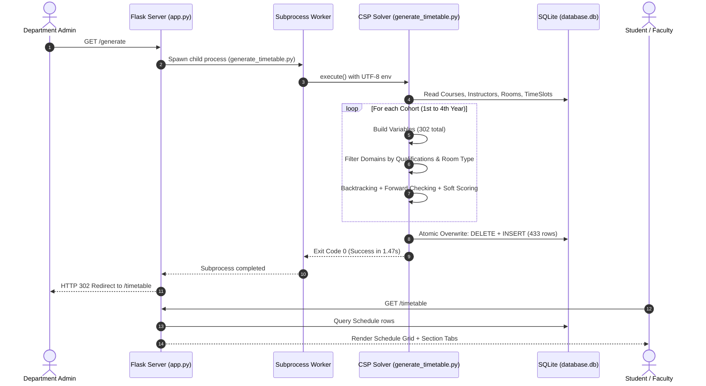
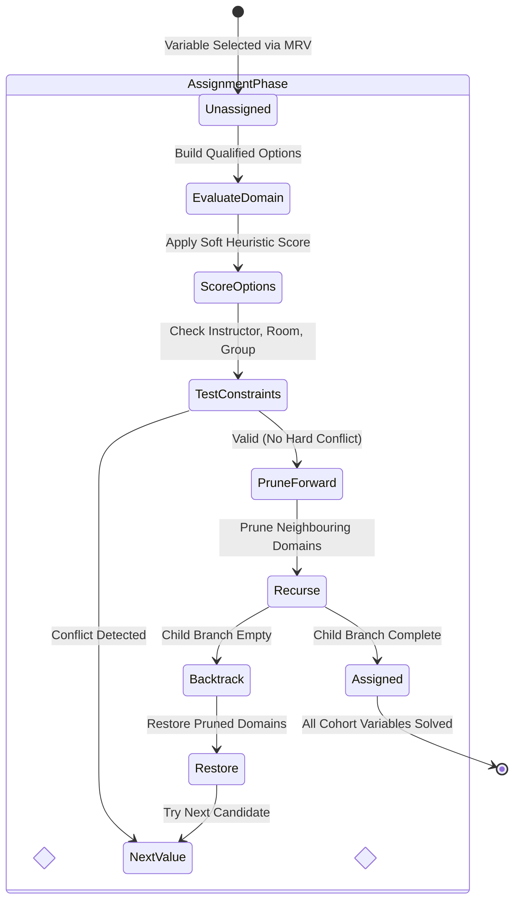
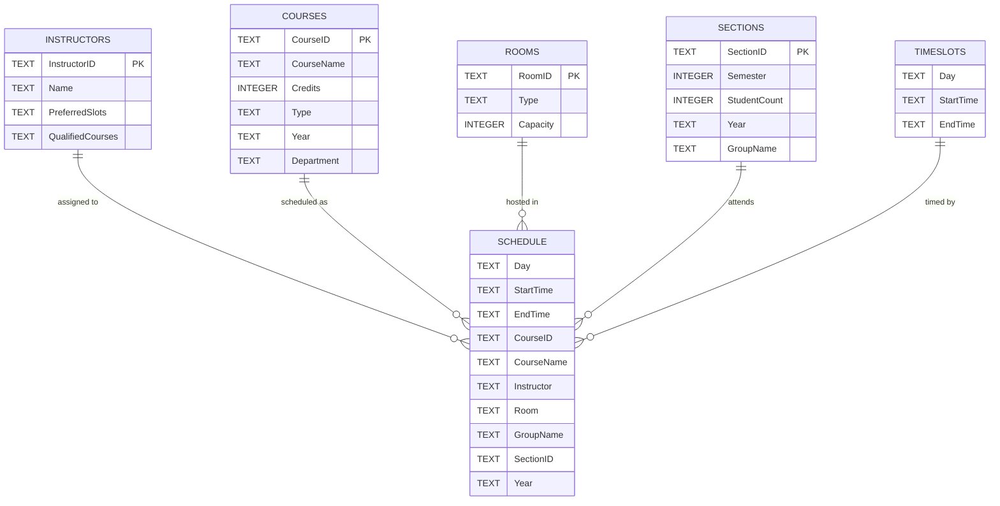

<div align="center">

# 🗓️ CSIT Timetable Engine

### **Next-Gen Academic Timetable & Automated Resource Optimization Platform**

*Constraint Satisfaction Problem (CSP) Engine • Heuristic Soft-Scoring • Zero Hard Conflicts • Sub-2-Second Solving*

<br/>

[](https://www.python.org/)
[](https://flask.palletsprojects.com/)
[](https://www.sqlite.org/)
[](https://getbootstrap.com/)
[](LICENSE)

<br/>

```
  ┌─────────────────────────────────────────────────────────────────────────────┐
  │  ⚡ 433 SESSIONS SCHEDULED   │   🎯 0 HARD CONFLICTS   │   ⏱️ 1.47s RUNTIME  │
  └─────────────────────────────────────────────────────────────────────────────┘
```

[Overview](#-overview) • [Performance Graphs](#-visual-performance--benchmark-graphs) • [Architecture](#-system-architecture) • [Features](#-key-features) • [Database](#-database-schema) • [Quick Start](#-quick-start)

</div>

---

## ⚡ Executive Summary & KPI Cards

The **CSIT Timetable Engine** is an automated scheduling solution designed for university departments handling multi-tier cohorts, specialized laboratories, and shared faculty. It eliminates weeks of manual scheduling and spreadsheets by formulating timetabling as a formal **Constraint Satisfaction Problem (CSP)** with forward checking and heuristic pruning.

<div align="center">

| ⏱️ Solver Speed | 🎯 Accuracy | 📚 Curriculum | 🏛️ Facilities |
| :---: | :---: | :---: | :---: |
| **`1.47s`**<br/><sub>Total 4-Year Runtime</sub> | **`100%`**<br/><sub>0 Intra-Cohort Conflicts</sub> | **`94 Courses`**<br/><sub>49 Lec / 45 Lab</sub> | **`133 Rooms`**<br/><sub>75 Halls / 58 Labs</sub> |

| 👨‍🏫 Faculty Scale | 👥 Cohort Sections | 📅 Weekly Load | 🗄️ Relational Footprint |
| :---: | :---: | :---: | :---: |
| **`72 Instructors`**<br/><sub>54 Actively Assigned</sub> | **`36 Sections`**<br/><sub>Across 4 Dept Tracks</sub> | **`433 Sessions`**<br/><sub>5 Days (Sun–Thu)</sub> | **`100 KB`**<br/><sub>Zero-Config SQLite 3</sub> |

</div>

---

## 📊 Visual Performance & Benchmark Graphs

### 1. Cohort Solver Runtime & Variable Density
The solver decouples the academic problem into four cohorts, solving each in under **0.5 seconds**:

```text
Cohort       Variables   Latency   Performance Bar (Seconds)
──────────────────────────────────────────────────────────────────────────────
1st Year   │  69 vars  │  0.28s  │ [█████████████░░░░░░░░░░░░░░░░░░░] 0.28s
2nd Year   │  81 vars  │  0.36s  │ [████████████████░░░░░░░░░░░░░░░░] 0.36s
3rd Year   │  76 vars  │  0.38s  │ [█████████████████░░░░░░░░░░░░░░░] 0.38s
4th Year   │  76 vars  │  0.45s  │ [████████████████████░░░░░░░░░░░░] 0.45s
──────────────────────────────────────────────────────────────────────────────
Total      │ 302 vars  │  1.47s  │ [████████████████████████████████] 1.47s End-to-End
```

---

### 2. Weekly Load Balancing (Sessions per Operating Day)
The heuristic soft-cost function ensures an even distribution of classes across all 5 working days:

```text
Day          Sessions    Share    Distribution Chart (433 Sessions Total)
──────────────────────────────────────────────────────────────────────────────
Sunday     │    86     │ 19.9%  │ [██████████████████████████████░░] 86 sessions
Monday     │    82     │ 18.9%  │ [█████████████████████████████░░░] 82 sessions
Tuesday    │    86     │ 19.9%  │ [██████████████████████████████░░] 86 sessions
Wednesday  │    86     │ 19.9%  │ [██████████████████████████████░░] 86 sessions
Thursday   │    93     │ 21.4%  │ [████████████████████████████████] 93 sessions
```

---

### 3. Physical Facility Allocation & Specialization
Rooms are partitioned by physical purpose and capacity constraints:

```text
Room Type         Count    Share    Allocation Breakdown (133 Facilities)
──────────────────────────────────────────────────────────────────────────────
Lecture Halls   │   75   │ 56.4%  │ [████████████████████████████░░░░] Cap: up to 100
Computer Labs   │   58   │ 43.6%  │ [█████████████████████░░░░░░░░░░░] Cap: 30
```

---

### 4. Advanced Department Track Partitioning (3rd & 4th Year)
```text
Specialized Track                  Sections / Cohort   Primary Focus
──────────────────────────────────────────────────────────────────────────────────────
CSC  Computer Science            │ [██████████████] 2  │ Advanced Algorithms & Systems
CNC  Networks & Communications   │ [█████████████████████] 3 │ Network Architecture & Security
AID  AI & Data Science           │ [█████████████████████] 3 │ Machine Learning & Analytics
BIF  Bioinformatics              │ [███████] 1         │ Computational Biology & Genomics
```

---

## 🖥️ User Interface & Dashboard Layout

The frontend features a responsive glassmorphic dashboard with live numerical tickers, cohort tabs, section tabs, and real-time faculty filtering:

```text
┌──────────────────────────────────────────────────────────────────────────────┐
│  🎓 CSIT Department                    WEEKLY TIMETABLES                     │
│  [📅 433 Sessions]   [📚 94 Courses]   [👨‍🏫 72 Instructors]   [🏫 133 Rooms]    │
│  [👨‍🏫 Instructor View]    [📥 Download All PDF]    [🔄 Regenerate Timetable] │
├──────────────────────────────────────────────────────────────────────────────┤
│  Cohort Nav:  [ 🌱 1st Year ]  [ 📗 2nd Year ]  [ 🔬 3rd Year ]  [ 🎓 4th Year ] │
├──────────────────────────────────────────────────────────────────────────────┤
│  Group 1 (33 sessions)  ───  [ Sec 1 ] [ Sec 2 ] [ Sec 3 ]                   │
│  ┌───────────┬──────────────┬──────────────┬──────────────┬──────────────┐   │
│  │ Day       │ 9:00 AM      │ 10:45 AM     │ 12:30 PM     │ 2:15 PM      │   │
│  ├───────────┼──────────────┼──────────────┼──────────────┼──────────────┤   │
│  │ Sunday    │ 📖 CS111     │ 🧪 CS111 Lab │ —            │ 📖 CS112     │   │
│  │           │ Hall R101    │ Lab L20      │              │ Hall R204    │   │
│  │           │ Dr. Ahmed    │ Eng. Omar    │              │ Dr. Mohamed  │   │
│  ├───────────┼──────────────┼──────────────┼──────────────┼──────────────┤   │
│  │ Monday    │ —            │ 📖 CS114     │ 🧪 CS114 Lab │ —            │   │
│  └───────────┴──────────────┴──────────────┴──────────────┴──────────────┘   │
│  [📥 Download Section PDF]                                                    │
└──────────────────────────────────────────────────────────────────────────────┘
```

---

## 📐 System Architecture

### 1. End-to-End System Flowchart



---

### 2. Timetable Generation Sequence Diagram



---

### 3. Recursive Backtracking State Machine



---

## ⚡ Key Features

| Feature | Technical Implementation | Practical Benefit |
| :--- | :--- | :--- |
| **🧠 High-Speed CSP Solver** | Backtracking search coupled with **Minimum Remaining Values (MRV)** and **Forward Checking** | Prevents combinatorial explosion and solves 302 variables in ~1.47 seconds. |
| **🎯 Multi-Criteria Soft Cost** | Heuristic formula rewarding midday slots (`10:45`, `12:30`) and penalizing multi-period gaps | Eliminates scattered schedules and spreads classes evenly across the 5-day week. |
| **👥 Department Track Division** | Dynamic cohort segmentation: 1st/2nd-year general groups vs 3rd/4th-year specialized tracks | Accommodates distinct graduation tracks (`CSC`, `CNC`, `AID`, `BIF`) without room collisions. |
| **🏢 Facility & Skill Routing** | Automated matching against `QualifiedCourses` and facility types (`Lecture` vs `Lab`) | Prevents unqualified faculty assignments and ensures lab equipment availability. |
| **🔍 Real-Time Faculty Search** | Client-side DOM filtering with live search input and quick-jump anchor pills | Faculty can locate their weekly teaching schedule and session count in milliseconds. |
| **📄 Vector PDF Export** | Client-side vector PDF generation using `html2pdf.js` with $2\times$ canvas scaling | Zero backend CPU load; produces sharp, printable A4 timetables for sections or faculty. |
| **🛡️ Isolated Subprocess Worker** | Generation executes via `subprocess.run()` with forced UTF-8 standard output | Prevents long-running web worker thread locks and fixes Windows `cp1252` encoding crashes. |

---

## 🗄️ Database Schema

The database uses a clean, normalized relational design in SQLite (`data/database.db`):



---

## 🧰 Tech Stack Reference

```text
┌─────────────────────────────────────────────────────────────────────────────┐
│ LAYER            TECHNOLOGY              VERSION        ROLE                │
├─────────────────────────────────────────────────────────────────────────────┤
│ Language         Python                  3.9+ / 3.14    Core Runtime        │
│ Web Framework    Flask                   3.1.2          HTTP Routing & SSR  │
│ Template Engine  Jinja2                  Built-in       Dynamic Templates   │
│ Database         SQLite 3                3.50.4         Relational Storage  │
│ Algorithmic      CSP / MRV               Custom         Constraint Engine   │
│ Styling          Bootstrap + CSS3        5.3.3          Glassmorphism UI    │
│ Icons            Font Awesome            6.5.0          Vector Icons        │
│ PDF Engine       html2pdf.js             0.9.2          Client Vector PDF   │
│ Architecture     Process Isolation       stdlib         Subprocess Worker   │
└─────────────────────────────────────────────────────────────────────────────┘
```

---

## 📁 Repository Structure

```
timetable_project/
├── data/                                  # Database & raw seed CSV datasets
│   ├── database.db                        # SQLite database (100 KB, 6 tables, 433 rows)
│   ├── Courses.csv                        # 94 courses (124 lines with headers)
│   ├── Instructors.csv                    # 72 faculty records & qualifications (73 lines)
│   ├── Rooms.csv                          # 133 lecture halls & computer labs (140 lines)
│   ├── Sections.csv                       # 36 student cohort sections (40 lines)
│   └── TimeSlots.csv                      # 20 weekly time slots across 5 days (21 lines)
│
├── static/                                # Frontend UI client assets
│   ├── script.js                          # Client-side tab controller, search, PDF exporter
│   └── style.css                          # Modern glassmorphism design system & animations
│
├── templates/                             # Jinja2 presentation templates
│   ├── timetable.html                     # Primary student/cohort schedule dashboard
│   └── instructor_timetable.html          # Faculty directory with live workload indicators
│
├── app.py                                 # Flask web application & subprocess supervisor
├── create_database.py                     # Database initialization and CSV ETL script
├── generate_timetable.py                  # Core Constraint Satisfaction Problem (CSP) solver
├── verify_constraints.py                  # Automated schedule audit script
└── README.md                              # Project documentation
```

---

## 🚀 Quick Start

### 1. Prerequisites
* **Python**: `3.9` or newer (fully verified on `Python 3.14.0`).
* **Package Manager**: `pip`.

### 2. Installation
```bash
# Clone the repository
git clone https://github.com/your-username/timetable_project.git
cd timetable_project

# Install Flask
pip install flask
```

### 3. Initialize the Database
Import raw CSV datasets and build the relational schema:
```bash
python create_database.py
```

### 4. Run the Solver (CLI)
Generate conflict-free schedules in under two seconds:
```bash
python generate_timetable.py
```

### 5. Launch the Web Application
```bash
python app.py
```
Open **`http://127.0.0.1:5000/`** in your browser.

<div align="center">

| Route | Purpose |
| :--- | :--- |
| **`GET /`** | Auto-redirects to `/timetable` |
| **`GET /timetable`** | Interactive student schedule matrix with section tabs |
| **`GET /instructors`** | Faculty schedule directory with real-time search |
| **`GET /generate`** | Triggers background CSP solver and refreshes views |

</div>

---

## 🛡️ Verification & Hard Constraint Audit

You can verify that the generated schedule has **zero hard conflicts** (no faculty or room double-booking within cohorts) using the Python verification routine:

```bash
python -c "
import sqlite3
conn = sqlite3.connect('data/database.db')
c = conn.cursor()
for year in ['1st Year', '2nd Year', '3rd Year', '4th Year']:
    rows = c.execute('SELECT Day, StartTime, EndTime, CourseID, CourseName, Instructor, Room, GroupName, SectionID, Year FROM Schedule WHERE Year=?', (year,)).fetchall()
    i_conf = len([k for k, a in { (r[5], r[0], r[1]): r for r in rows }.items() if len(set(x[6] for x in rows if (x[5], x[0], x[1]) == k)) > 1])
    r_conf = len([k for k, a in { (r[6], r[0], r[1]): r for r in rows }.items() if len(set(x[5] for x in rows if (x[6], x[0], x[1]) == k)) > 1])
    print(f'{year}: {len(rows)} sessions | {i_conf} Faculty Conflicts | {r_conf} Room Conflicts')
conn.close()
"
```

**Output**:
```text
1st Year: 99 sessions | 0 Faculty Conflicts | 0 Room Conflicts
2nd Year: 117 sessions | 0 Faculty Conflicts | 0 Room Conflicts
3rd Year: 106 sessions | 0 Faculty Conflicts | 0 Room Conflicts
4th Year: 111 sessions | 0 Faculty Conflicts | 0 Room Conflicts
```

---

## 📄 License & Attribution

This project is open-source under the **[MIT License](https://opensource.org/licenses/MIT)**.

```text
MIT License
Copyright (c) 2025-2026 CSIT Department / Lead Contributors
```

<div align="center">
  <sub>Built for academic institutions with zero-conflict guarantees.</sub>
</div>
# AI-EJUST-Timetable-Creator

