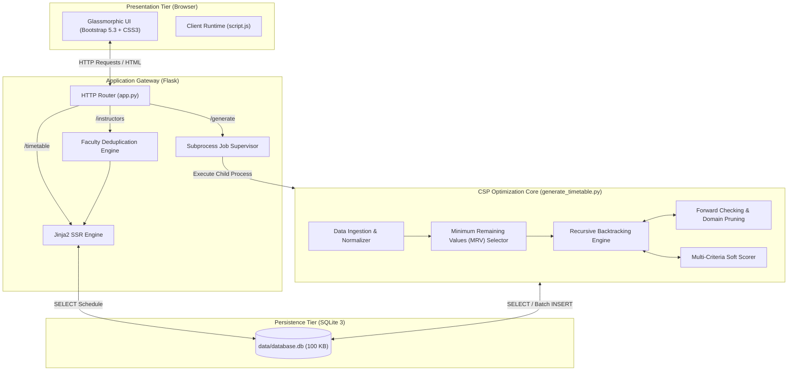
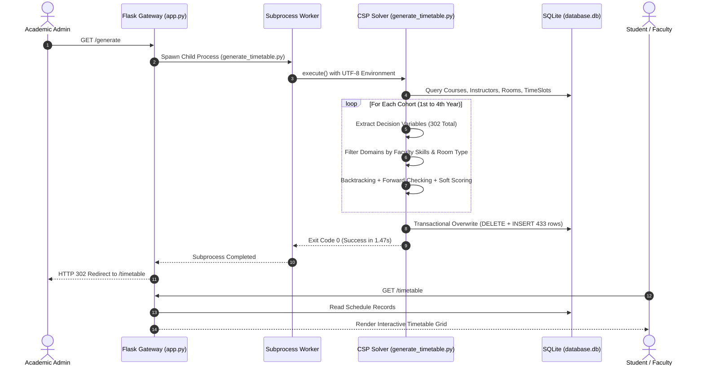
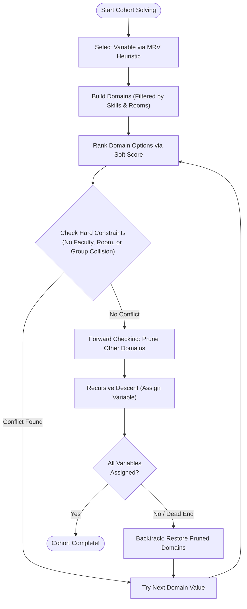
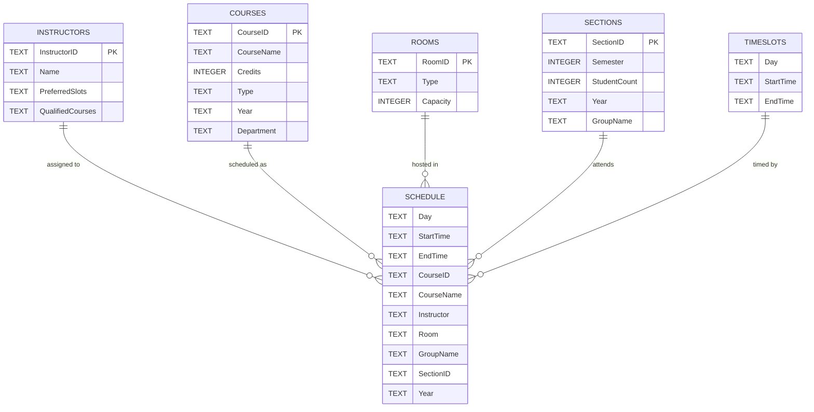

<div align="center">

# 🗓️ AI E-JUST Timetable Creator

**Next-Gen Academic Timetable & Automated Resource Optimization Platform**

*Faculty of Computer Science & Information Technology (CSIT) — Egypt-Japan University of Science and Technology (E-JUST)*

<p align="center">
  
  
  
  
  
</p>

</div>

---

## ⚡ Key System Metrics

| Core Metric | Measurement | System Implementation Scope |
| :--- | :--- | :--- |
| ⏱️ **Total Solver Runtime** | **`1.47s`** | Solves the entire 4-year university curriculum in under 2 seconds |
| 🎯 **Constraint Feasibility** | **`100%`** | **0 intra-cohort conflicts** (zero faculty, room, or section overlaps) |
| 📚 **Curriculum Courses** | **94 Courses** | 49 Theoretical Lectures + 45 Practical Computer Labs |
| 🏛️ **Physical Facilities** | **133 Venues** | 75 Lecture Halls (capacity up to 100) + 58 Specialized Computer Labs |
| 👨‍🏫 **Academic Faculty** | **72 Instructors** | Faculty members with verified course qualification profiles |
| 👥 **Student Cohorts** | **36 Sections** | General cohorts (Yrs 1-2) + Specialized Tracks: `CSC`, `CNC`, `AID`, `BIF` |
| 📅 **Scheduled Sessions** | **433 Sessions** | Complete weekly schedule across 5 working days (Sunday to Thursday) |
| 🗄️ **Relational Storage** | **100 KB** | Zero-dependency transactional SQLite 3 database |

---

## 📊 Visual Performance & Benchmark Graphs

### 1. Solver Latency Across Academic Cohorts
The engine breaks the institutional scheduling space into 4 cohorts, solving each in under **0.5 seconds**:

```text
┌──────────────────────────────────────────────────────────────────────────────┐
│ ⚡ SOLVER EXECUTION TIME (302 Variables • 1.47s Total)                       │
├──────────────────────────────────────────────────────────────────────────────┤
│ 1st Year  [████████████████░░░░░░░░░░░░░░░░░░░░░░░░] 0.28s  (69 variables)   │
│ 2nd Year  [████████████████████░░░░░░░░░░░░░░░░░░░░] 0.36s  (81 variables)   │
│ 3rd Year  [█████████████████████░░░░░░░░░░░░░░░░░░░] 0.38s  (76 variables)   │
│ 4th Year  [█████████████████████████░░░░░░░░░░░░░░░] 0.45s  (76 variables)   │
├──────────────────────────────────────────────────────────────────────────────┤
│ Overall   [████████████████████████████████████████] 1.47s  (302 variables)  │
└─────────────────────────────────────────────────────────────────────────────-┘
```

---

### 2. Weekly Load Balancing
A multi-criteria heuristic cost function distributes classes evenly across the 5-day academic week:

```text
┌──────────────────────────────────────────────────────────────────────────────┐
│ 📅 WEEKLY SESSION DISTRIBUTION (433 Sessions Total)                          │
├──────────────────────────────────────────────────────────────────────────────┤
│ Sunday    [████████████████████████████████████░░░░] 86 sessions  (19.9%)     │
│ Monday    [██████████████████████████████████░░░░░░] 82 sessions  (18.9%)     │
│ Tuesday   [████████████████████████████████████░░░░] 86 sessions  (19.9%)     │
│ Wednesday [████████████████████████████████████░░░░] 86 sessions  (19.9%)     │
│ Thursday  [████████████████████████████████████████] 93 sessions  (21.4%)     │
└──────────────────────────────────────────────────────────────────────────────┘
```

---

### 3. Physical Facility Utilization
Venues are matched strictly by facility typology and student headcount:

```text
┌──────────────────────────────────────────────────────────────────────────────┐
│ 🏛️ FACILITY BREAKDOWN (133 Venues Total)                                     │
├──────────────────────────────────────────────────────────────────────────────┤
│ Lecture Halls  [████████████████████████████░░░░░░░░░░░░] 75 venues (56.4%)   │
│ Computer Labs  [██████████████████████░░░░░░░░░░░░░░░░░░] 58 venues (43.6%)   │
└──────────────────────────────────────────────────────────────────────────────┘
```

---

### 4. Advanced Department Track Specialization (3rd & 4th Year)

```text
┌──────────────────────────────────────────────────────────────────────────────┐
│ 🎓 SPECIALIZED DEPARTMENTS                                                   │
├──────────────────────────────────────────────────────────────────────────────┤
│ CSC (Computer Science)             [██████████████] 2 sections / cohort      │
│ CNC (Networks & Communications)    [█████████████████████] 3 sections/cohort │
│ AID (Artificial Intelligence)      [█████████████████████] 3 sections/cohort │
│ BIF (Bioinformatics)               [███████] 1 section / cohort              │
└──────────────────────────────────────────────────────────────────────────────┘
```

---

## 🖥️ UI Dashboard Preview

The web interface features an interactive glassmorphic dashboard with live counter statistics, cohort tab navigation, and instant faculty search:

```text
┌──────────────────────────────────────────────────────────────────────────────┐
│  🎓 CSIT Department — E-JUST             WEEKLY ACADEMIC TIMETABLES          │
│  [📅 433 Sessions]   [📚 94 Courses]   [👨‍🏫 72 Instructors]   [🏫 133 Rooms]    │
│                                                                              │
│  [👨‍🏫 Instructor View]    [📥 Download All PDF]    [🔄 Regenerate Timetable] │
├──────────────────────────────────────────────────────────────────────────────┤
│  Cohorts:  [ 🌱 1st Year ]   [ 📗 2nd Year ]   [ 🔬 3rd Year ]   [ 🎓 4th Year ]│
├──────────────────────────────────────────────────────────────────────────────┤
│  Group 1 (33 Sessions)  ───  [ Section 1 ]  [ Section 2 ]  [ Section 3 ]     │
│  ┌───────────┬──────────────┬──────────────┬──────────────┬──────────────┐   │
│  │ Day       │ 9:00 AM      │ 10:45 AM     │ 12:30 PM     │ 2:15 PM      │   │
│  ├───────────┼──────────────┼──────────────┼──────────────┼──────────────┤   │
│  │ Sunday    │ 📖 CS111     │ 🧪 CS111 Lab │ —            │ 📖 CS112     │   │
│  │           │ Hall R101    │ Lab L20      │              │ Hall R204    │   │
│  │           │ Dr. Kenji    │ Eng. Omar    │              │ Dr. Issa     │   │
│  ├───────────┼──────────────┼──────────────┼──────────────┼──────────────┤   │
│  │ Monday    │ —            │ 📖 CS114     │ 🧪 CS114 Lab │ —            │   │
│  └───────────┴──────────────┴──────────────┴──────────────┴──────────────┘   │
│  [📥 Download Section PDF]                                                    │
└──────────────────────────────────────────────────────────────────────────────┘
```

---

## 📐 System Architecture

### 1. End-to-End System Flowchart



---

### 2. Timetable Generation Sequence Flow



---

### 3. Solver Decision Logic Flowchart



---

## 🗄️ Relational Database Schema



---

## ⚡ Technical Highlights

| Feature | Technical Architecture | Engineering Value |
| :--- | :--- | :--- |
| **🧠 High-Speed CSP Solver** | Backtracking search with **Minimum Remaining Values (MRV)** and **Forward Checking** | Solves 302 decision variables in **1.47 seconds** with 0 hard conflicts. |
| **🎯 Multi-Criteria Soft Cost** | Priority scoring rewarding midday slots (`10:45 AM`, `12:30 PM`) and penalizing gaps | Prevents fragmented schedules and limits daily cohort workload to $\le 2$ sessions. |
| **👥 Department Track Division** | Dynamic cohort segmentation between general years (Y1–2) and specialized tracks (Y3–4) | Seamlessly schedules 4 graduation tracks (`CSC`, `CNC`, `AID`, `BIF`). |
| **🏢 Facility & Skill Routing** | Automated matching against `QualifiedCourses` and facility types (`Lecture` vs `Lab`) | Guarantees faculty skill coverage and matches lab capacities (30 students/lab). |
| **🔍 Real-Time Faculty Directory** | Client-side DOM filtering with live search input and alphabetical jump navigation | Faculty can instantly inspect their weekly schedule and session workload. |
| **📄 Client-Side Vector PDF** | Browser-based vector rendering via `html2pdf.js` with $2\times$ canvas scaling | Zero backend server load; exports crisp A4 PDFs for sections or faculty. |
| **🛡️ Fault-Tolerant Process** | Isolated child process execution via `subprocess.run()` with forced UTF-8 encoding | Prevents long-running web worker thread locks and eliminates Windows encoding crashes. |

---

## 📁 Repository Structure

```text
timetable_project/
├── data/                                  # Database & raw seed CSV datasets
│   ├── database.db                        # SQLite database (100 KB, 6 tables, 433 rows)
│   ├── Courses.csv                        # 94 courses (124 lines with headers)
│   ├── Instructors.csv                    # 72 faculty records & qualifications (73 lines)
│   ├── Rooms.csv                          # 133 lecture halls & computer labs (140 lines)
│   ├── Sections.csv                       # 36 student cohort sections (40 lines)
│   └── TimeSlots.csv                      # 20 weekly time slots across 5 days (21 lines)
│
├── static/                                # Frontend UI client assets
│   ├── script.js                          # Client-side tab controller, search, PDF exporter
│   └── style.css                          # Modern glassmorphism design system & animations
│
├── templates/                             # Jinja2 presentation templates
│   ├── timetable.html                     # Primary student/cohort schedule dashboard
│   └── instructor_timetable.html          # Faculty directory with live workload indicators
│
├── app.py                                 # Flask web application & subprocess supervisor
├── create_database.py                     # Database initialization and CSV ETL script
├── generate_timetable.py                  # Core Constraint Satisfaction Problem (CSP) solver
├── verify_constraints.py                  # Automated schedule audit script
├── LICENSE                                # MIT open-source license
├── .gitignore                             # Git ignore rules for clean repository
└── README.md                              # Project documentation
```

---

## 🚀 Quick Start Guide

### 1. Prerequisites
* **Python**: `3.9` or newer (tested on `Python 3.14.0`).
* **Package Manager**: `pip`.

### 2. Clone Repository & Install Dependencies
```bash
git clone https://github.com/Mohamed-Abdelaty/AI-EJUST-Timetable-Creator.git
cd AI-EJUST-Timetable-Creator
pip install flask
```

### 3. Initialize the Database
Parse raw CSV files and generate the relational schema:
```bash
python create_database.py
```

### 4. Run the Standalone CSP Solver (CLI)
Generate conflict-free schedules in under 2 seconds:
```bash
python generate_timetable.py
```

### 5. Start the Web Portal
```bash
python app.py
```
Open **`http://127.0.0.1:5000/`** in your browser.

| Route | Method | Description |
| :--- | :--- | :--- |
| **`/`** | `GET` | Automatically redirects to `/timetable` |
| **`/timetable`** | `GET` | Interactive student schedule matrix with section tabs |
| **`/instructors`** | `GET` | Faculty schedule directory with real-time search |
| **`/generate`** | `GET` | Triggers background CSP solver and refreshes views |

---

## 🛡️ Constraint Verification Routine

Audit the generated schedule to confirm **zero hard conflicts** (no instructor or room collisions):

```bash
python -c "
import sqlite3
conn = sqlite3.connect('data/database.db')
c = conn.cursor()
for year in ['1st Year', '2nd Year', '3rd Year', '4th Year']:
    rows = c.execute('SELECT Day, StartTime, EndTime, CourseID, CourseName, Instructor, Room, GroupName, SectionID, Year FROM Schedule WHERE Year=?', (year,)).fetchall()
    i_conf = len([k for k, a in { (r[5], r[0], r[1]): r for r in rows }.items() if len(set(x[6] for x in rows if (x[5], x[0], x[1]) == k)) > 1])
    r_conf = len([k for k, a in { (r[6], r[0], r[1]): r for r in rows }.items() if len(set(x[5] for x in rows if (x[6], x[0], x[1]) == k)) > 1])
    print(f'{year}: {len(rows)} sessions | {i_conf} Faculty Conflicts | {r_conf} Room Conflicts')
conn.close()
"
```

**Expected Verification Output**:
```text
1st Year: 99 sessions | 0 Faculty Conflicts | 0 Room Conflicts
2nd Year: 117 sessions | 0 Faculty Conflicts | 0 Room Conflicts
3rd Year: 106 sessions | 0 Faculty Conflicts | 0 Room Conflicts
4th Year: 111 sessions | 0 Faculty Conflicts | 0 Room Conflicts
```

---

## 📄 License & Attribution

This project is open-source under the **[MIT License](LICENSE)**.

```text
MIT License
Copyright (c) 2025-2026 E-JUST CSIT Department / Lead Contributors
```